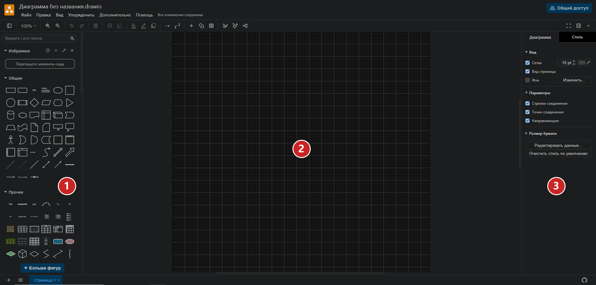
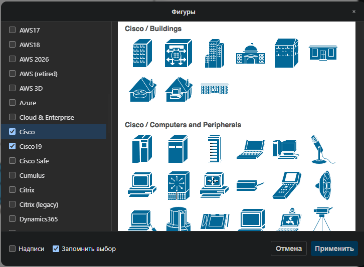
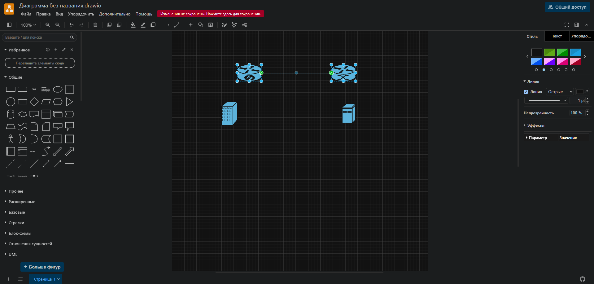
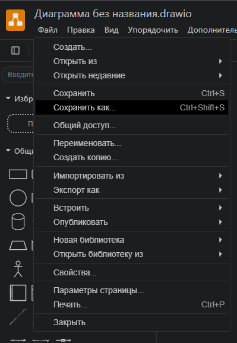
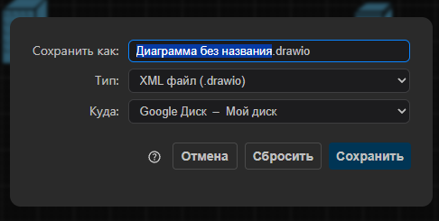
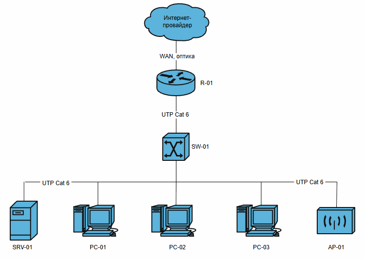

# Веб-приложение draw.io. Руководство пользователя

**Создание структурной схемы локальной вычислительной сети**

| | |
|---|---|
| Документ | Руководство пользователя (РП) |
| Разработан в соответствии с | ГОСТ Р 59795-2021, п. 6.4 |
| Версия ПО | draw.io (app.diagrams.net), веб-версия 32.7.5 |
| Редакция документа | 1.0, ноябрь 2026 |
| Автор | Ковалев Д. Ю. |

---

## Содержание

1. [Введение](#1-введение)
2. [Назначение и условия применения](#2-назначение-и-условия-применения)
3. [Подготовка к работе](#3-подготовка-к-работе)
4. [Описание операций](#4-описание-операций)
5. [Аварийные ситуации](#5-аварийные-ситуации)
6. [Рекомендации по освоению](#6-рекомендации-по-освоению)
7. [Термины и сокращения](#7-термины-и-сокращения)

---

## 1. Введение

### 1.1 Область применения

Руководство описывает работу в веб-приложении draw.io при подготовке структурной схемы локальной вычислительной сети (ЛВС) для проектной, рабочей или эксплуатационной документации.

### 1.2 Краткое описание возможностей

draw.io — бесплатное приложение для построения диаграмм и схем. Приложение позволяет:

- размещать на листе условные обозначения сетевого оборудования из встроенных библиотек;
- соединять элементы линиями связи с подписями;
- задавать оформление элементов: цвет, толщину линий, шрифт;
- сохранять схему в собственном формате `.drawio` для дальнейшего редактирования;
- экспортировать схему в форматы PDF, PNG и SVG для вставки в документацию.

### 1.3 Уровень подготовки пользователя

Пользователь должен:

- уверенно работать в веб-браузере и с файлами в ОС Windows или macOS;
- знать назначение основного сетевого оборудования: маршрутизатор, коммутатор, сервер, точка доступа.

Специальная подготовка по работе с draw.io не требуется.

### 1.4 Перечень эксплуатационной документации

Для освоения приложения достаточно настоящего руководства. Дополнительно можно использовать официальную справку draw.io: https://www.drawio.com/doc/

---

## 2. Назначение и условия применения

### 2.1 Назначение

Приложение предназначено для создания структурных и функциональных схем, блок-схем алгоритмов и диаграмм процессов. В рамках настоящего руководства рассматривается построение структурной схемы ЛВС.

### 2.2 Условия применения

| Требование | Значение |
|---|---|
| Браузер | Актуальная версия Google Chrome, Яндекс Браузер, Microsoft Edge или Mozilla Firefox |
| Подключение к интернету | Требуется для открытия веб-версии |
| Учётная запись | Не требуется при сохранении файлов на компьютер |

> **Примечание.** Для работы без интернета существует настольная версия draw.io для Windows, macOS и Linux. Её интерфейс совпадает с веб-версией.

---

## 3. Подготовка к работе

### 3.1 Запуск приложения

1. Откройте в браузере сайт https://www.drawio.com (рисунок 1).
2. Нажмите **Start Diagramming**.

Редактор также можно открыть напрямую по адресу https://app.diagrams.net.

*Рисунок 1 — Главная страница сайта draw.io*

### 3.2 Выбор языка интерфейса

Если интерфейс открылся на английском языке:

1. Откройте меню **Extras** (**Дополнительно**) → **Language** (**Язык**).
2. Выберите **Русский**.
3. Обновите страницу браузера, если язык не сменился сразу.

### 3.3 Проверка работоспособности

Приложение готово к работе, если открылось рабочее окно с меню **Файл**, **Правка**, **Вид**, **Упорядочить** и панелью фигур слева (рисунок 2).

---

## 4. Описание операций

### 4.1 Создание новой схемы

1. Выберите в меню **Файл → Создать**.
2. Новая схема создаётся с именем **Диаграмма без названия.drawio**. Имя файла задаётся при сохранении (п. 4.7).

**Результат:** открылось рабочее окно с пустым листом (рисунок 2).

*Рисунок 2 — Рабочее окно приложения: 1 — панель фигур; 2 — рабочий лист; 3 — панель форматирования*

### 4.2 Подключение библиотеки сетевого оборудования

По умолчанию сетевые обозначения не отображаются на панели фигур.

1. В нижней части панели фигур нажмите кнопку **+ Больше фигур**.
2. В окне **Фигуры** прокрутите список до группы **Сети** и установите флажок **Cisco** (рисунок 3).
3. Нажмите **Применить**.

**Результат:** на панели фигур появился раздел **Cisco** с условными обозначениями маршрутизатора, коммутатора, сервера, рабочей станции и точки доступа.

> **Примечание.** Библиотеки **Стойки и оборудование** (Rack / Cisco, Rack / Dell и др.) содержат изображения лицевых панелей оборудования. Они предназначены для схем размещения в телекоммуникационном шкафу, а не для структурных схем.

*Рисунок 3 — Окно «Фигуры», группа «Сети»*

### 4.3 Размещение оборудования на схеме

1. Найдите на панели фигур нужный элемент, например маршрутизатор.
2. Перетащите элемент на рабочий лист левой кнопкой мыши.
3. Повторите действия для остальных элементов схемы.

Для типовой схемы офисной ЛВС разместите:

- маршрутизатор — 1 шт.;
- коммутатор — 1 шт.;
- сервер — 1 шт.;
- рабочие станции — 3 шт.;
- точку доступа Wi-Fi — 1 шт.

> **Совет.** Чтобы быстро найти элемент, введите его название в поле поиска над панелью фигур.

### 4.4 Подпись элементов

1. Дважды щёлкните по элементу на листе.
2. Введите подпись, например `SW-01` для коммутатора.
3. Щёлкните по свободному месту листа, чтобы завершить ввод.

### 4.5 Соединение элементов линиями связи

1. Наведите указатель мыши на элемент. По краям элемента появятся синие стрелки.
2. Нажмите на стрелку и, удерживая кнопку мыши, протяните линию к другому элементу.
3. Отпустите кнопку, когда второй элемент подсветится.

**Результат:** элементы соединены линией. При перемещении элементов линия перестраивается автоматически.

Чтобы подписать линию (например, указать тип кабеля `UTP Cat 6`), дважды щёлкните по линии и введите текст.

*Рисунок 4 — Соединение элементов линией связи*

### 4.6 Оформление схемы

1. Выделите один или несколько элементов (для выделения нескольких удерживайте клавишу **Shift**).
2. На панели форматирования справа измените нужные параметры:
   - вкладка **Стиль** — цвет заливки, цвет и толщина линии;
   - вкладка **Текст** — шрифт, размер и положение подписи;
   - вкладка **Упорядочить** — размер, поворот и выравнивание элементов.

Если ни один элемент не выделен, на панели отображаются вкладки **Диаграмма** и **Стиль** с параметрами всего листа: сетка, фон, размер бумаги.

> **Совет.** Для оформления по ГОСТ используйте чёрный цвет линий, белую заливку и шрифт без засечек.

### 4.7 Сохранение схемы

При первом сохранении:

1. Выберите в меню **Файл → Сохранить как** (рисунок 5) или нажмите **Ctrl + Shift + S**.
2. В окне сохранения (рисунок 6) заполните поля:
   - **Сохранить как** — имя файла, например `ЛВС_офис_структурная.drawio`;
   - **Тип** — оставьте **XML файл (.drawio)**;
   - **Куда** — выберите **Это устройство**, чтобы сохранить файл на компьютер. По умолчанию может быть выбран облачный диск, например Google Диск.
3. Нажмите **Сохранить** и укажите папку.

Повторно сохраняйте схему сочетанием **Ctrl + S**. Пока изменения не сохранены, рядом с меню отображается красная надпись **Изменения не сохранены. Нажмите здесь для сохранения.**

**Результат:** схема сохранена в файл формата `.drawio`. Файл можно открыть в draw.io для дальнейшего редактирования.

*Рисунок 5 — Меню «Файл»*

*Рисунок 6 — Окно сохранения схемы*

### 4.8 Экспорт схемы для вставки в документ

1. Выберите в меню **Файл → Экспорт как → PDF**.
2. Чтобы экспортировать только часть схемы, выделите её заранее и установите флажок **Только выделение**.
3. Откройте раздел **Расширенные** и выберите **Вписать в 1 страниц(ы) в ширину на 1 страниц(ы) в высоту**. Схема целиком поместится на один лист.
4. Нажмите **Экспорт** и укажите папку для сохранения.

> **Примечание.** Флажок **Вложить копию моей диаграммы** включён по умолчанию. С ним PDF-файл можно снова открыть в draw.io и отредактировать.

| Формат | Когда использовать |
|---|---|
| PDF | Печать, вложение в комплект документации |
| PNG | Вставка в документы Word и презентации |
| SVG | Вставка в веб-документацию без потери качества при масштабировании |

*Рисунок 7 — Пример готовой структурной схемы ЛВС*

Исходный файл схемы: [ЛВС_офис_структурная.drawio.png](ЛВС_офис_структурная.drawio.png). Файл открывается в draw.io для редактирования (**Файл → Открыть из → Это устройство**).

---

## 5. Аварийные ситуации

| Ситуация | Причина | Действия пользователя |
|---|---|---|
| Приложение не открывается | Нет подключения к интернету или адрес заблокирован | Проверьте подключение к интернету. Используйте настольную версию draw.io |
| Вкладка браузера закрыта до сохранения | Схема не была сохранена | Изменения могут быть потеряны. Сохраняйте схему каждые 10–15 минут (**Ctrl + S**) |
| Элемент удалён по ошибке | Действие пользователя | Нажмите **Ctrl + Z** |
| Схема в PDF обрезана | Элементы выходят за границы листа | В окне экспорта откройте **Расширенные** и выберите **Вписать в 1 × 1 страниц(ы)** (п. 4.8) |
| Не найдена нужная фигура | Библиотека не подключена | Подключите библиотеку по п. 4.2 |

---

## 6. Рекомендации по освоению

1. Выполните операции раздела 4 по порядку на примере схемы офисной ЛВС.
2. Освойте горячие клавиши: **Ctrl + C / Ctrl + V** — копирование, **Ctrl + D** — дублирование, **Ctrl + Z** — отмена, **Ctrl + колёсико мыши** — масштаб.
3. Для повторяющихся схем сохраните оформленный файл как шаблон и создавайте новые схемы на его основе.

---

## 7. Термины и сокращения

| Термин | Определение |
|---|---|
| ЛВС | Локальная вычислительная сеть |
| Структурная схема | Схема, определяющая основные функциональные части изделия, их назначение и взаимосвязи (ГОСТ 2.701-2008) |
| Библиотека фигур | Набор условных обозначений на панели фигур draw.io |
| Экспорт | Сохранение схемы в формате, отличном от `.drawio` |
