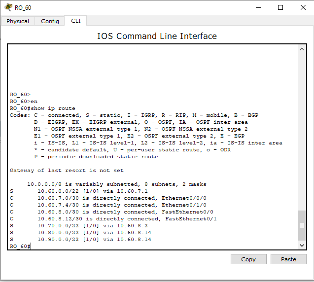
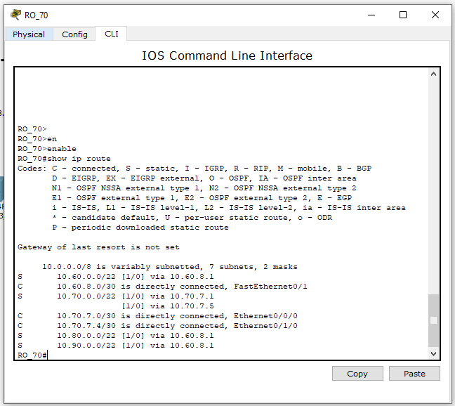
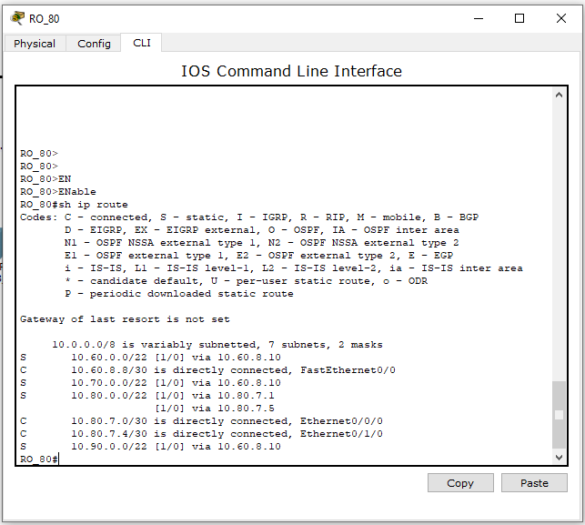
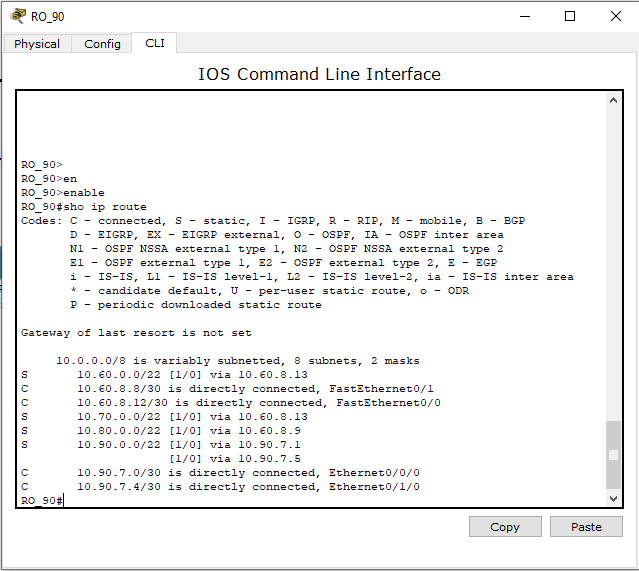
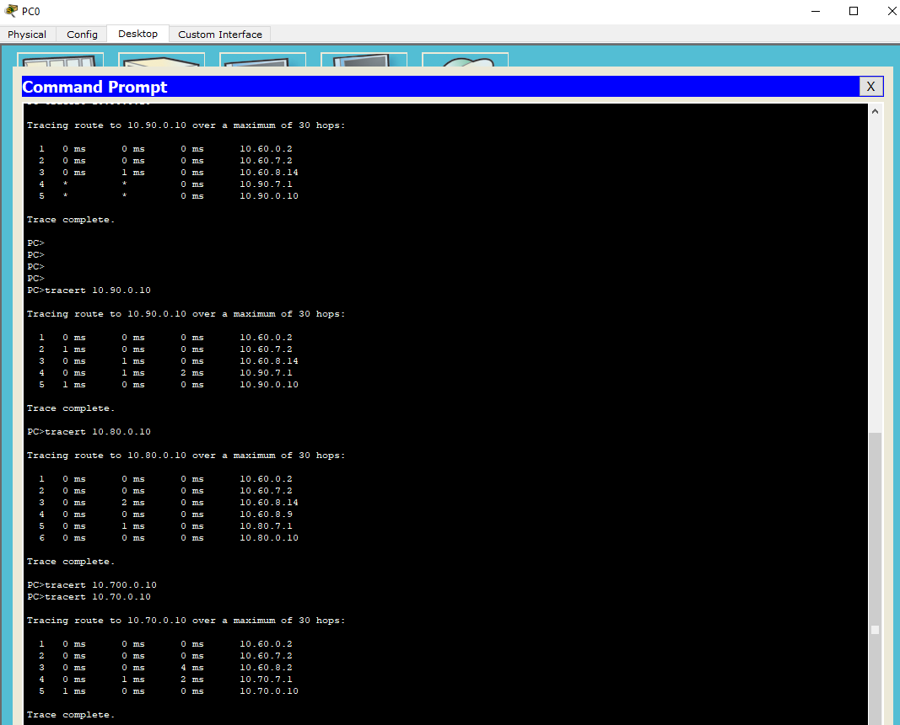

# Маршрутизация между сегментами

Среда — Cisco Packet Tracer.

Проверил пути трафика на стенде с 4 маршрутизаторами, 8 L3-коммутаторами и 4 ПК. В конфигурации использовал статические маршруты и HSRP.

## Скриншоты

