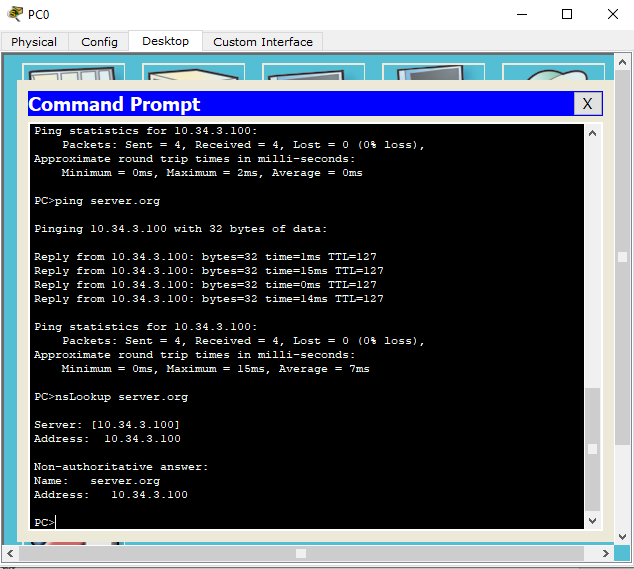
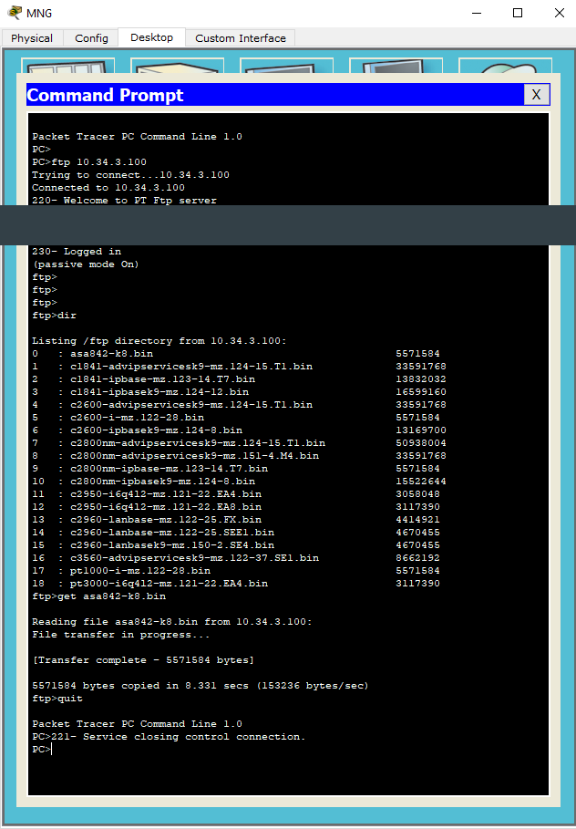
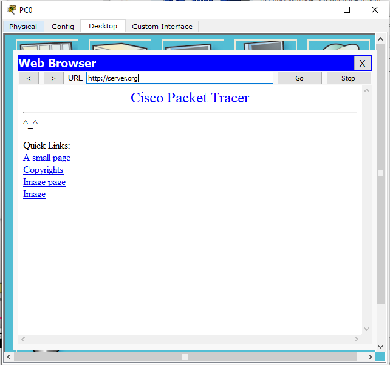
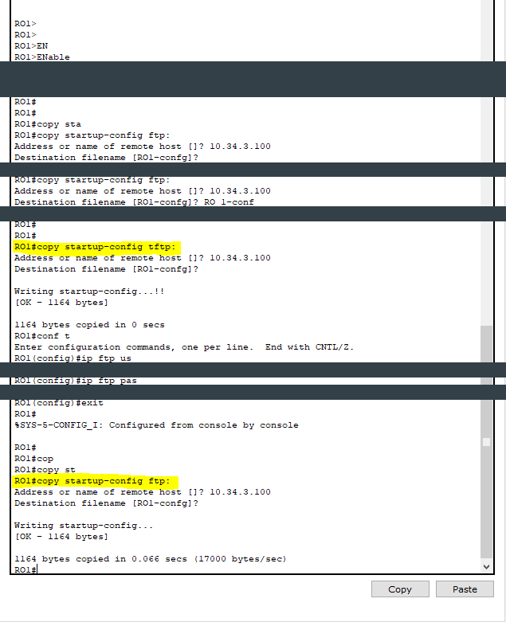
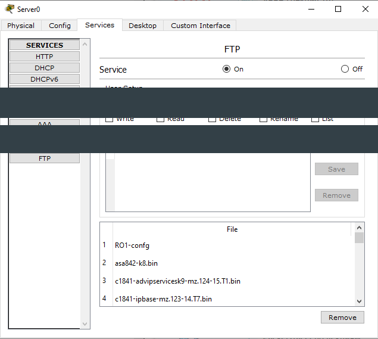
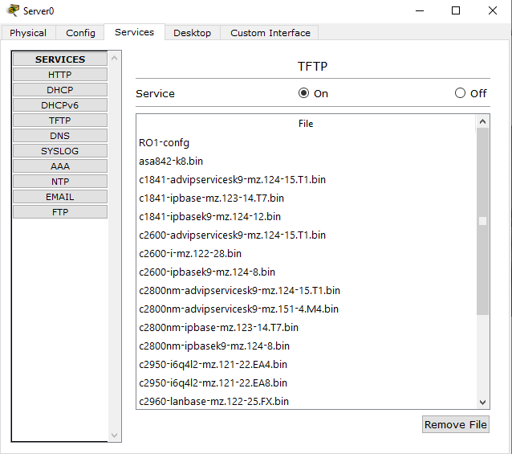

# Проверка сетевых сервисов

Среда — Cisco Packet Tracer.

Проверил DNS через nslookup, открыл страницу по HTTP и сохранил конфигурацию маршрутизатора через TFTP. Отдельно проверил доступ к FTP.

## Скриншоты

