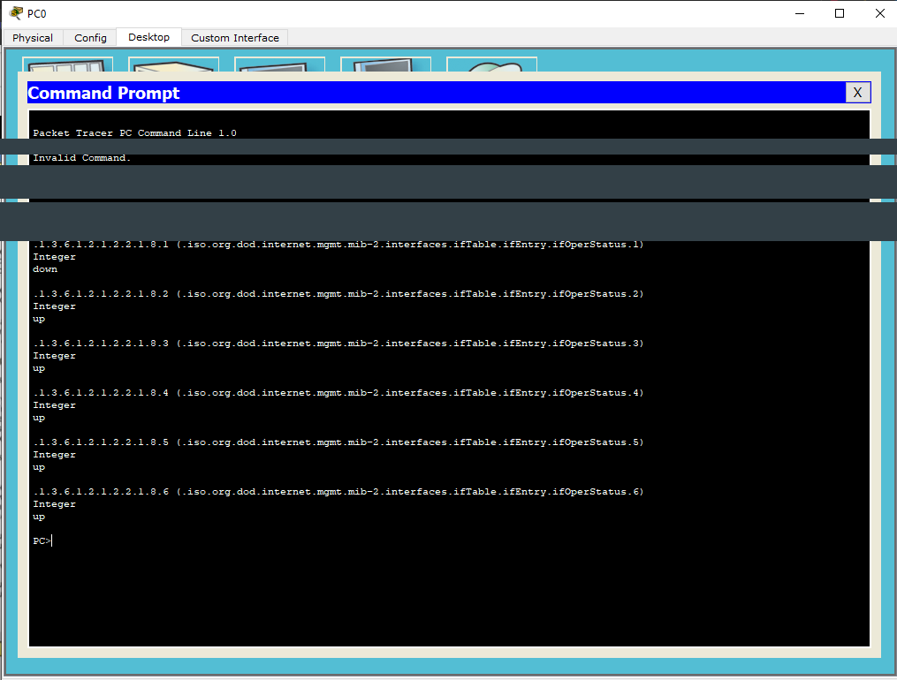
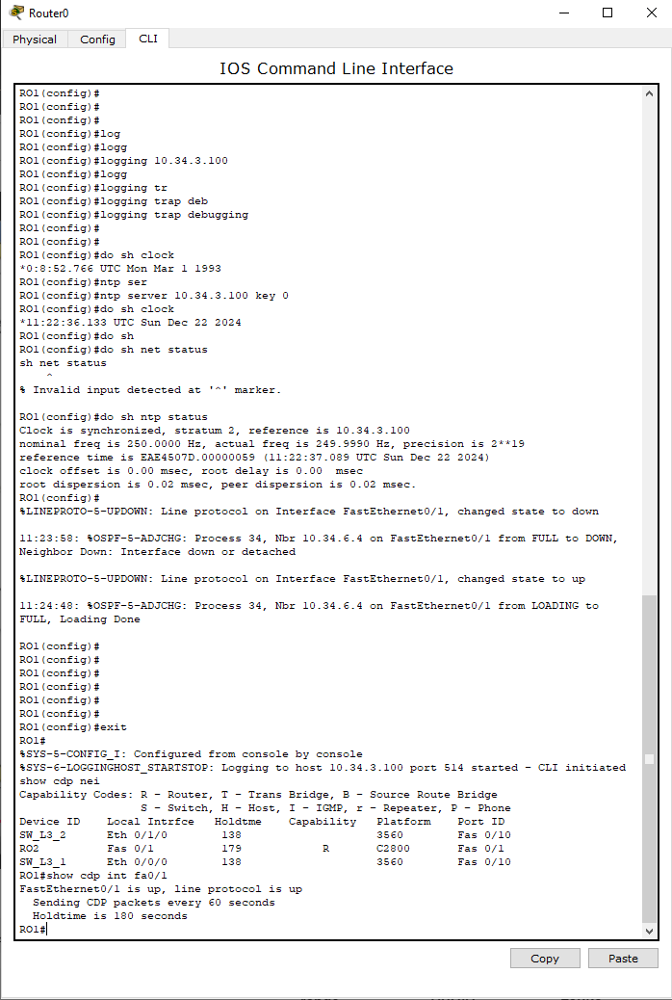
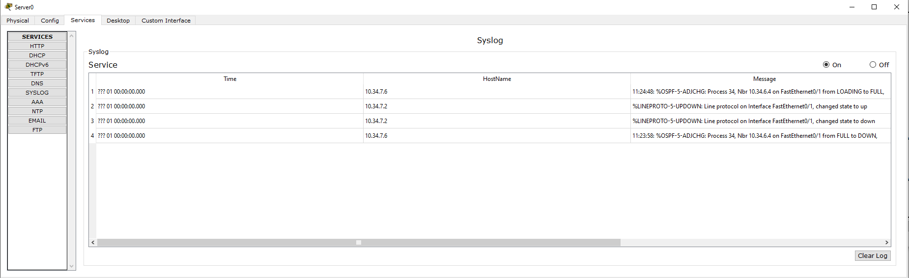

# Диагностика через SNMP, Syslog и NTP

Среда — Cisco Packet Tracer.

Проверил состояние интерфейсов через SNMP, синхронизацию часов и события падения и восстановления OSPF-соседства в Syslog.

## Скриншоты

