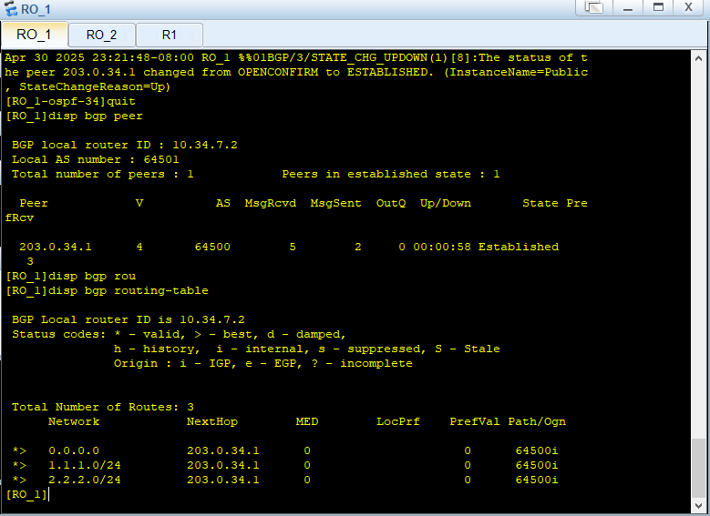
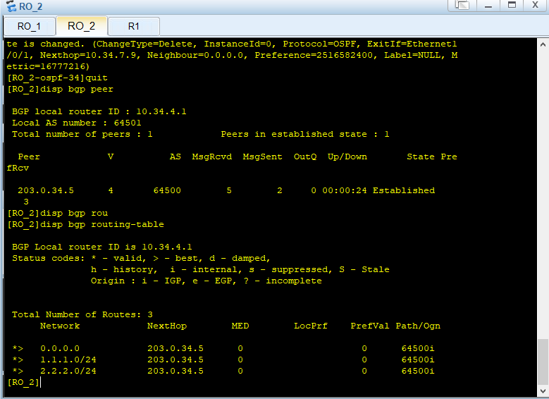

# BGP-соседство и маршруты

Среда — Huawei eNSP.

Проверил сессии Established и таблицы BGP на двух маршрутизаторах. Сценарий управления выбором пути сохранён отдельно как постановка задачи.

## Скриншоты

