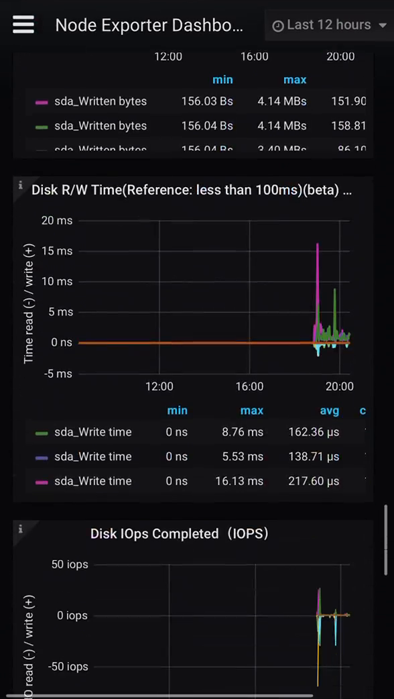

# Мониторинг трёх Linux-станций с Prometheus и Grafana

Развернул централизованный мониторинг трёх рабочих станций Ubuntu Desktop. Собрал стенд в VirtualBox, проверил связность между узлами, настроил сбор метрик и открыл дашборд Grafana со смартфона в той же локальной сети. На момент проверки Prometheus показывал **3 из 3 станций в состоянии `UP`**.

## Задача

Собрать показатели CPU, памяти, дисков и сетевых интерфейсов трёх станций в одном месте. Через браузер должно быть видно, опрашиваются ли станции, и как меняется их нагрузка со временем. Отдельно проверил, что интерфейс мониторинга доступен с другого устройства в локальной сети.

## Архитектура стенда

| Компонент | Где запущен | Роль |
| --- | --- | --- |
| Node Exporter | Три ВМ с Ubuntu Desktop | Предоставляет метрики ОС по HTTP на конечной точке `/metrics`, порт `9100/tcp`. |
| Prometheus | ВМ с Ubuntu Server | Опрашивает Node Exporter на каждой станции, хранит метрики и показывает статус опроса. Веб-интерфейс на порту `9090/tcp`. |
| Grafana | Та же ВМ с Ubuntu Server | Запрашивает данные у Prometheus и отображает их на дашборде. Веб-интерфейс на порту `3000/tcp`. |
| Oracle VirtualBox | Хост стенда | Подключает виртуальные машины к локальной сети в режиме сетевого моста. |
| Смартфон | Та же локальная сеть | Открывает веб-интерфейсы Prometheus и Grafana через браузер. |

~~~mermaid
flowchart LR
    subgraph stations["Три станции Ubuntu Desktop"]
        A["Node Exporter · станция 1"]
        B["Node Exporter · станция 2"]
        C["Node Exporter · станция 3"]
    end
    subgraph server["Ubuntu Server"]
        P["Prometheus"]
        G["Grafana"]
    end
    P -->|"HTTP-опрос → :9100/metrics"| A
    P -->|"HTTP-опрос → :9100/metrics"| B
    P -->|"HTTP-опрос → :9100/metrics"| C
    G -->|"Источник данных → localhost:9090"| P
    M["Смартфон в локальной сети"] -->|"Дашборд → :3000"| G
~~~

## Развёртывание и проверка

### Сеть VirtualBox

Перевёл сетевые интерфейсы ВМ в режим **Bridged Adapter**. Сервер и станции получили адреса из одной подсети. Проверил связность через `ping`. На записи одного из тестов между станциями видно **21 из 21 ответа, потерь нет**. Этот тест подтверждает связность конкретной пары узлов во время проверки. Доступность HTTP-сервисов проверял отдельно.

### Node Exporter

Установил Node Exporter на трёх рабочих станциях и запустил как службу systemd. Через `curl` проверил, что конечная точка `/metrics` возвращает метрики. Это проверка всей цепочки до конкретного экспортера, включая доступность HTTP-порта и ответ приложения.

### Prometheus

На Ubuntu Server запустил Prometheus как службу systemd. В `prometheus.yml` добавил три цели в группу `linux_nodes`. На странице **Targets** проверил, что для каждой станции отображаются статус `UP` и время последнего опроса. На записи также видно, что Prometheus опрашивает собственную конечную точку отдельной группой.

### Grafana

Установил Grafana на сервер мониторинга через Snap и открыл порт `3000/tcp` для доступа к веб-интерфейсу. Добавил Prometheus как источник данных по адресу `http://localhost:9090` и проверил соединение через **Save & Test**. Затем импортировал готовый дашборд Node Exporter и связал его с этим источником.

### Проверка со смартфона

Со смартфона в той же локальной сети открыл **Targets** в Prometheus и дашборд в Grafana. Проверил выбор станций и графики загрузки CPU, памяти, системной нагрузки, сетевого трафика и дисковых операций. Для дисков на записи видны, в частности, графики времени чтения и записи и числа операций ввода-вывода.

## Результат и ограничение

| Проверка | Что увидел |
| --- | --- |
| Связность между двумя станциями | 21 из 21 ответа на `ping`. |
| Доступность Node Exporter | Получил вывод системных метрик по HTTP. |
| Опрос трёх рабочих станций | `linux_nodes (3/3 up)` на странице целей Prometheus. |
| Дашборд с другого устройства | Открыл Grafana в мобильном браузере и просмотрел графики метрик. |
| Совместимость импортированного шаблона | Одна панель запрашивала отсутствующий плагин `table-old`. Графики CPU, памяти и дисковой активности при этом отображались. |

Ошибка панели осталась открытой. Проверка подтвердила, что в момент записи Prometheus получал метрики от трёх станций и Grafana отображала их на поддерживаемых панелях.

## Скриншоты со стенда

### Проверка связности из терминала Ubuntu

### Состояние целей Prometheus

### Дашборд Grafana со смартфона

### Дисковые метрики в Grafana

