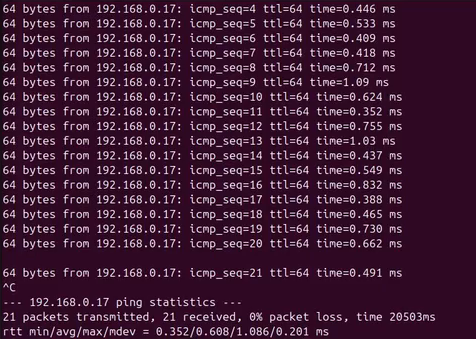
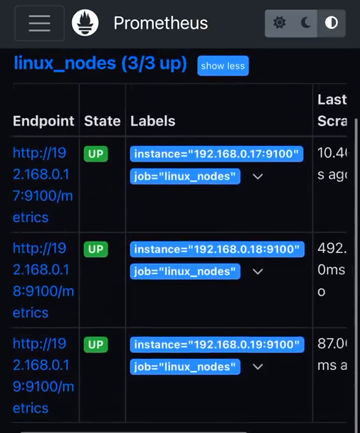
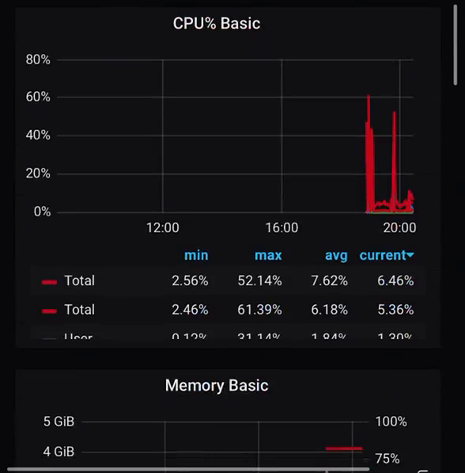

# Мониторинг Linux-станций в локальной сети

Развернул централизованный мониторинг трёх рабочих станций Ubuntu. Цель проекта — собирать системные метрики на одном сервере и просматривать их с компьютера или смартфона в той же сети.

## Архитектура стенда

- **Ubuntu Server** — центральный сервер с Prometheus и Grafana.
- **Три станции Ubuntu Desktop** — Node Exporter на каждой станции, запущенный через systemd.
- **Oracle VirtualBox** — виртуальные машины подключены к локальной сети через сетевой мост.

Prometheus опрашивает конечные точки Node Exporter по HTTP. Grafana использует Prometheus как источник данных. Дашборд доступен с устройства в той же локальной сети.

## Что сделал

1. Настроил сетевой мост в VirtualBox и проверил доступность узлов через `ping`.
2. Развернул Node Exporter на трёх станциях и проверил выдачу метрик через `curl`.
3. Добавил три цели опроса в `prometheus.yml`, запустил Prometheus как службу systemd и проверил статус целей.
4. Подключил Prometheus к Grafana и импортировал дашборд Node Exporter. Проверил просмотр со смартфона.

## Что показала проверка

- Prometheus обнаружил **3 из 3** рабочих станций в состоянии `UP`.
- На мобильном дашборде отображались графики CPU, памяти, дисковой активности, сетевого трафика и системной нагрузки.
- Одна из панелей импортированного шаблона требовала плагин `table-old`, отсутствующий на стенде. Статус целей и остальные показанные на записи графики были доступны.

## Скриншоты

### Связность между станциями

### Цели опроса в Prometheus

### Grafana на смартфоне

